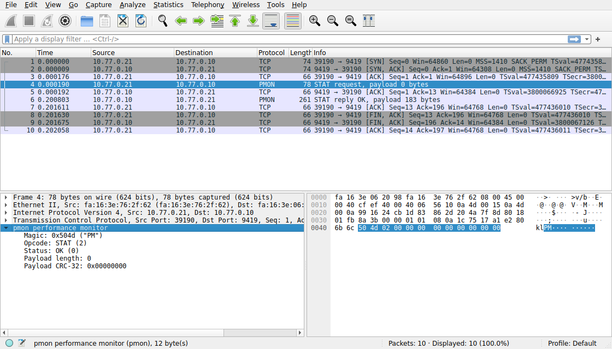
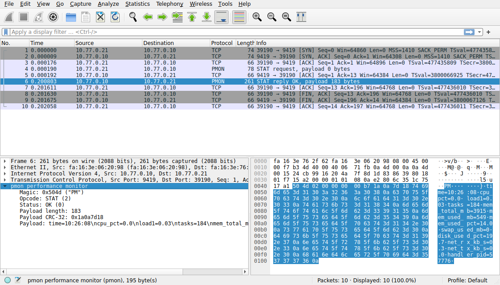

# 封包擷取與分析

一次 `pmon stat` 的完整連線，用 `tcpdump` 擷取。

| 檔案 | 環境 | 產生方式 |
|---|---|---|
| `capture/stat-lo.pcap`、`.txt` | 單機 loopback | `demo/03-capture.sh` |
| `capture/stat-ens4.pcap`、`.txt` | 跨機：`nsp-client-1`（10.77.0.21）→ `nsp-server`（10.77.0.10） | `demo/03-capture.sh ens4 remote` |

`.pcap` 可以直接用 Wireshark 開啟。以下以 loopback 的擷取為例，跨機的結果結構完全相同。

## 1. 整條連線：10 個封包

client 的埠是 58396，server 是 9419。

| # | 時間 | 方向 | 旗標 | 資料長度 | 意義 |
|---|---|---|---|---|---|
| 1 | .683795 | client → server | `S` | 0 | 三向交握：SYN |
| 2 | .683806 | server → client | `S.` | 0 | 三向交握：SYN + ACK |
| 3 | .683816 | client → server | `.` | 0 | 三向交握：ACK，連線建立 |
| 4 | .683841 | client → server | `P.` | 12 | **請求訊框**（只有標頭） |
| 5 | .683845 | server → client | `.` | 0 | 確認收到請求 |
| 6 | .884327 | server → client | `P.` | 195 | **回應訊框**（12 位元組標頭 + 183 位元組內容） |
| 7 | .884335 | client → server | `.` | 0 | 確認收到回應 |
| 8 | .884371 | client → server | `F.` | 0 | client 關閉連線：FIN |
| 9 | .884475 | server → client | `F.` | 0 | server 也關閉：FIN |
| 10 | .884485 | client → server | `.` | 0 | 確認，連線結束 |

可以觀察到的事：

- **封包 4 到 6 相隔 0.2 秒**。這是 server 計算 CPU 使用率與網路速率時，兩次取樣之間的間隔（`STAT_WINDOW_MS`），不是網路延遲。
- **請求與回應各只佔一個 TCP 封包**。`proto_send()` 把標頭和內容放進同一個緩衝區一次送出，所以不會被拆成兩段。
- **由 client 先送 FIN**。client 拿到回應後關閉 socket；server 的 child 讀到 EOF，記錄「disconnected」後結束，於是送出自己的 FIN。
- **序號可以對上資料長度**。請求佔 `seq 1:13`（12 位元組），回應佔 `seq 1:196`（195 位元組），FIN 各佔一個序號。

## 2. 請求訊框：12 位元組

封包 4 的 TCP 資料（IP 標頭 20 位元組、TCP 標頭 32 位元組之後）：

```
504d 0200 0000 0000 0000 0000
```

| 位元組 | 值 | 欄位 | 解讀 |
|---|---|---|---|
| 0–1 | `50 4d` | magic | ASCII `PM`，表示這是 pmon 協定 |
| 2 | `02` | opcode | 2 = STAT |
| 3 | `00` | status | 請求固定為 0 |
| 4–7 | `00 00 00 00` | length | 內容長度 0，STAT 不帶參數 |
| 8–11 | `00 00 00 00` | crc32 | 空內容的 CRC-32 是 0 |

## 3. 回應訊框：12 + 183 位元組

封包 6 的 TCP 資料開頭：

```
504d 0200 0000 00b7 1165 f848 7469 6d65 3d31 303a ...
                              t i  m e  = 1  0 :
```

| 位元組 | 值 | 欄位 | 解讀 |
|---|---|---|---|
| 0–1 | `50 4d` | magic | `PM` |
| 2 | `02` | opcode | 2 = STAT，與請求相同 |
| 3 | `00` | status | 0 = OK |
| 4–7 | `00 00 00 b7` | length | 0xb7 = 183 位元組 |
| 8–11 | `11 65 f8 48` | crc32 | 內容的 CRC-32 |
| 12– | `74 69 6d 65 3d ...` | payload | `time=10:26:04\ncpu_pct=2.5\n...` |

多位元組欄位是 network byte order（高位在前）：長度 183 寫成 `00 00 00 b7`，不是 x86 記憶體裡的 `b7 00 00 00`。
程式用 `put32()`、`get32()` 逐位元組組合，不依賴機器的位元組順序。

TCP 資料長度 195 = 標頭 12 + 內容 183，與 length 欄位一致。

內容是 `key=value` 文字行，在擷取結果的右側可以直接閱讀：

```
time=10:26:04.cpu_pct=2.5.load1=0.03.tasks=187.mem_total_mb=3915.mem_used_mb=549...
```

（`.` 是換行字元 0x0a，`tcpdump` 把不可見字元顯示成句點。）

## 4. 跨機擷取的差異

`capture/stat-ens4.txt` 與 loopback 的差別只在網路層：

| 項目 | loopback | 跨機 |
|---|---|---|
| 位址 | 127.0.0.1 → 127.0.0.1 | 10.77.0.21 → 10.77.0.10 |
| MSS | 65495 | 1410（實體網路的 MTU 扣掉 VXLAN 封裝與標頭） |
| 封包 6 到 7 的間隔 | 0.008 ms | 0.8 ms（真的經過網路） |

應用層的 12 位元組標頭與內容格式完全相同。

## 5. 從封包看到的安全問題

- **內容是明文**。任何能在路徑上擷取封包的人，都能讀到主機的 CPU、記憶體、行程數等資訊。
- **沒有認證**。任何連得到 9419 埠的人都能查詢。
- **CRC-32 只能偵測傳輸錯誤，不能防竄改**。攻擊者改了內容後可以重算 CRC。

這三點是期中的已知限制。期末專案的 Security 項目（加密、認證）就是針對它們。
目前的防護是部署在不對外的獨立測試網段上。

## 用 Wireshark 檢視跨機擷取

Wireshark 不認得自訂的協定，預設只會把訊框顯示成一串 TCP 資料。`docs/capture/pmon.lua` 是一支 Lua 解析器，告訴 Wireshark 埠 9419 上的資料前 12 位元組各是什麼欄位。

```
wireshark -X lua_script:docs/capture/pmon.lua docs/capture/stat-ens4.pcap
tshark    -X lua_script:docs/capture/pmon.lua -r docs/capture/stat-ens4.pcap -Y pmon -O pmon
```

封包 4，client（10.77.0.21）送給 server（10.77.0.10）的請求：



封包 6，server 的回應：



- 第 4、6 個封包的 Protocol 欄顯示 PMON，Info 欄是解析器產生的摘要。
- 左下方是解析結果：請求的內容長度為 0、CRC 為 0；回應的內容長度為 183、CRC 為 `0x1a0a7d18`。
- 右下方反白的位元組就是 pmon 訊框，它前面的位元組是 Ethernet、IP、TCP 三層的標頭。

畫面由 `docs/report/wireshark-shot.sh` 在虛擬顯示器上開啟 Wireshark 後擷取。
